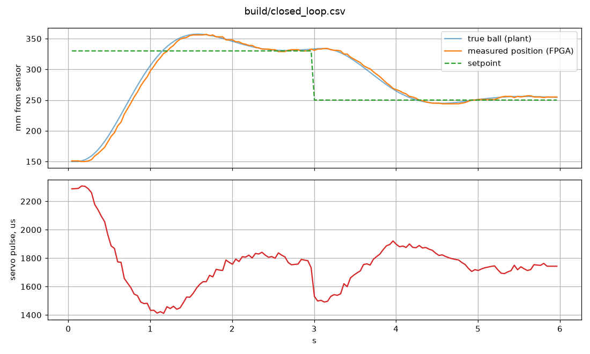
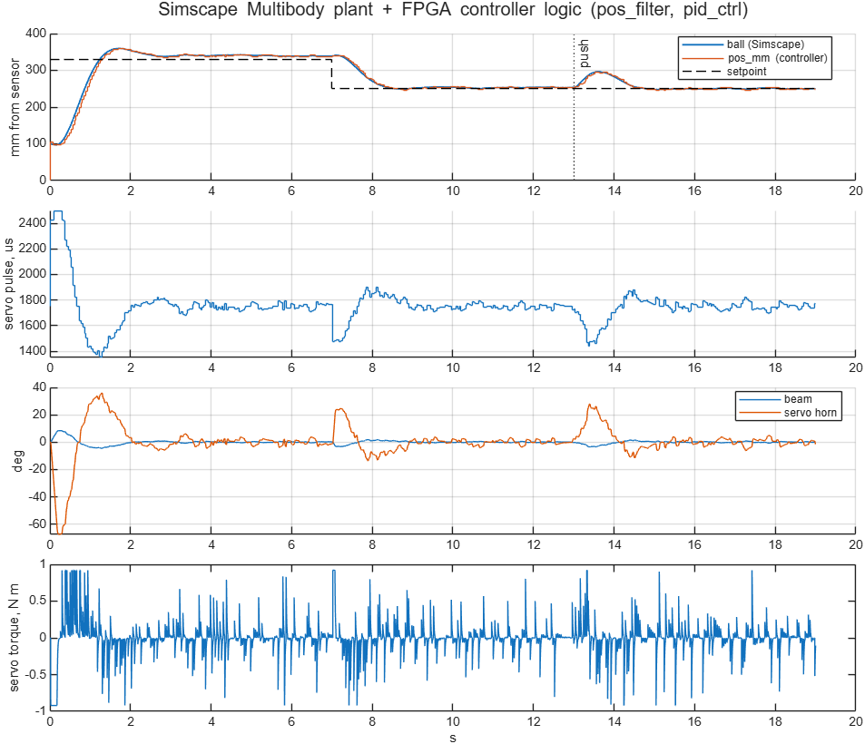
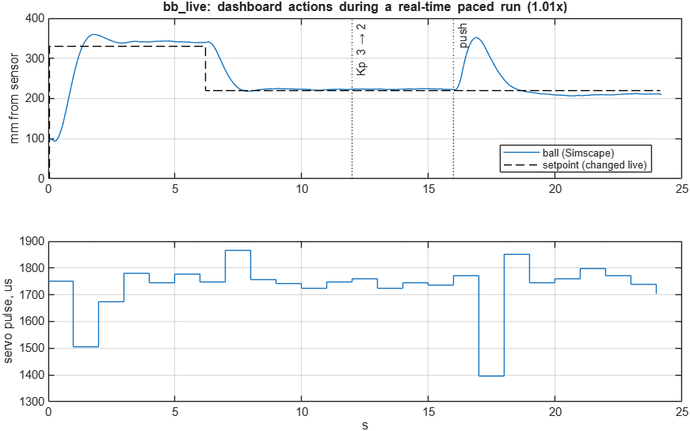
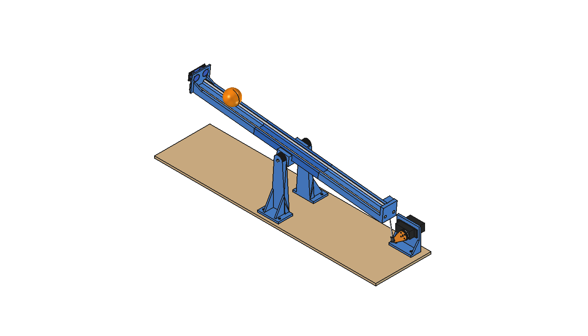

## Ball and Beam on FPGA (Simulink → HDL Coder → Spartan-6)

Ball-and-beam controller for the **Posedge-One** board (Xilinx Spartan-6
**XC6SLX9-2TQG144**, 24 MHz oscillator, FT2232H USB-UART). All control logic is
modelled in **Simulink** and turned into VHDL by **HDL Coder**. The generated
RTL is checked with **GHDL** in two ways: cycle by cycle against Simulink, and
in a closed-loop system test with a simulated ball and beam.

```
HC-SR04 ──echo──► io_sync ─► hcsr04_if ─► pos_filter ─► pid_ctrl ─► servo_pwm ──► MG996R
   ▲                            │ trig                       ▲   │
   └────────────────────────────┘                            │   └─► telemetry ─► uart_tx ──► PC
                       PC ──► uart_rx ─► cmd_regs (setpoint, gains, limits, mode …)
```

### Repository layout

| Path | Content |
|---|---|
| `simulink/bb_params.m` | every constant and power-up register default |
| `simulink/mlfb/*.m` | source of the 11 MATLAB Function blocks inside the DUT |
| `simulink/build_bb_model.m` | builds `bb_core.slx` (DUT `BallBeamCore` + plant/sensor/UART harness) |
| `simulink/gen_hdl.m` | runs HDL Coder (VHDL, Spartan-6 settings, synchronous reset) and the HDL Coder testbench |
| `simulink/tune_gains.m`, `bb_ctrl_ref.m`, `bb_plant_*.m` | sample-level plant model and bit-exact controller reference used to choose default gains |
| `hdl/bb_core/*.vhd` | **generated** VHDL (do not edit, regenerate) |
| `rtl/top_ball_beam.vhd` | hand-written board wrapper: reset synchroniser and power-on reset, pin names |
| `constraints/top_ball_beam.ucf` | pinout and 24 MHz timing constraint (derived from `PosedgeOne.ucf`) |
| `tb/tb_closed_loop.vhd` | GHDL system test: HC-SR04 model, ball-beam physics, UART host and monitor |
| `scripts/run_ghdl.sh` | compiles everything with GHDL and runs either test |
| `python/bb_uart.py` | PC tool: registers, telemetry monitor, live plot, interactive shell |
| `python/plot_csv.py` | plots `build/closed_loop.csv` or a recorded telemetry log |
| `simscape/` | Simscape Multibody rig model driven by the controller blocks, verification, CAD export |
| `cad/` | OpenSCAD parts and assembly built from the simulated geometry; STLs in `cad/stl/` (see `cad/README.md`) |
| `legacy/` | the previous hand-written design (kept for reference) |

### Rebuild flow

```matlab
cd simulink
build_bb_model;      % creates bb_core.slx, runs fine in Simulink
gen_hdl(true);       % VHDL -> ../hdl/bb_core, plus HDL Coder testbench vectors
```
```bash
scripts/run_ghdl.sh hdlcoder      # RTL vs. Simulink, cycle by cycle (35 ms of vectors)
scripts/run_ghdl.sh               # 6 s closed-loop test (~25 min with GHDL mcode)
python python/plot_csv.py build/closed_loop.csv
```
GHDL closed-loop result (generated RTL + wrapper, simulated plant, ±2 mm sensor noise):



ISE project: add `hdl/bb_core/*.vhd` (in `BallBeamCore_compile.do` order) and
`rtl/top_ball_beam.vhd`, top = `top_ball_beam`, UCF = `constraints/top_ball_beam.ucf`,
device xc6slx9-2tqg144.

### Simscape Multibody verification (mechanical design)

`simscape/bb_simscape.slx` puts the controller in closed loop with a 3-D
multibody model of the rig. The controller blocks are the **same MATLAB
Function sources HDL Coder converts to VHDL** (`simulink/mlfb/pos_filter.m`,
`pid_ctrl.m`) with the FPGA power-up register values. They are fed by an
HC-SR04 model with ±2 mm noise and 1 µs quantisation, and the servo pulse is
latched every 20 ms like `servo_pwm`.

Mechanical design (all values in `simscape/bb_mech_params.m`):

| Part | Choice |
|---|---|
| Ball | 40 mm ping-pong ball (2.7 g): light, cheap, good ultrasonic target |
| Track | two Ø6 mm steel rods, 560 mm, 24 mm apart, in a printed PLA cradle; ball centre 31.6 mm above the pivot axis |
| Pivot | beam centre, Ø5 mm axle in 2× 625ZZ bearings, 130 mm above the base, two printed towers |
| Sensor | HC-SR04 on the beam at the near end (x = −270 mm), so it always measures along the track |
| Actuator | MG996R on the base under the far end; 34 mm printed horn arm; 70 mm pushrod with M3 ball links to a bracket 250 mm from the pivot → beam ≈ 0.136 × servo angle |
| Servo model | internal P loop, 0.92 N·m stall torque, 7 rad/s no-load speed, reflected rotor inertia |

Rolling is modelled with a prismatic joint carrying the rolling-equivalent mass
`m + I/r_eff²` (r_eff = 17.1 mm on the two rods) plus a constant upward force
`(I/r_eff²)·g`, so the ball accelerates at `g·sinα·m/(m+I/r_eff²)`.
`test_rolling.m` checks this against theory (0.03 % error).

```matlab
cd simscape
run_verification          % builds the model, runs bb_scenario, PASS/FAIL, plot, CAD export
sweep_ki                  % compares Ki / ilim register settings
```

Default scenario: ball released at 100 mm, setpoint 330 mm, then 250 mm at 7 s,
then a 0.6 mN·s push at 13 s. Result with the FPGA defaults: offsets +9.2, +3.4
and +0.4 mm; noise σ 0.9 mm; beam within −4.5…+8.4°; servo torque saturated
1.8 % of the time. All 7 checks pass.



Register tuning found with `sweep_ki` (all are UART-writable, no rebuild):

| Ki / ilim | offset @330 / @250 | overshoot (first / second step) |
|---|---|---|
| defaults (0.008 / 200) | +9.2 / +3.4 mm | 30 / 1 mm |
| 0.1 / 60 (`set ki 0.1 ilim 60`) | +0.5 / +1.4 mm | 40 / 24 mm |

#### Live, interactive simulation

`build_bb_live` builds `simscape/bb_live.slx`. Open it and press **Run**. It
runs paced to real time until you press Stop, with Mechanics Explorer showing
the 3-D rig. Dashboard controls:

* **Setpoint slider** (60–470 mm)
* **Kp knob** (raw Q8.8, 768 = 3.0)
* **Push ball** button (6 mN on the ball while held)
* Scopes for ball position vs setpoint and servo pulse

It runs the same controller blocks at 2 kHz. Unpaced, it runs at about 2.4× real time even
with the 3-D view, so pacing holds 1.00×. `test_bb_live` drives the dashboard
parameters from timers during a paced run. Result: real-time factor 1.006, +2.1 mm
offset after a live setpoint change to 220 mm, 132 mm push deflection,
recovered.



#### FreeCAD assembly

`cad/freecad/bb_assembly.FCStd` is the rig as a FreeCAD 1.1 Assembly with
revolute, ball and slider joints. It includes a servo-sweep simulation and a macro that
replays the Simscape run, with FreeCAD's solver matching the Simscape beam
angle on every frame. See `cad/freecad/README.md`.



`export_cad_params.m` writes `cad/bb_params.scad` (OpenSCAD include, mm) and
`cad/bb_params.json`, so the printable parts are built from the simulated geometry.

### Pins (Posedge-One)

| Signal | Pin | Note |
|---|---|---|
| CLOCK | P50 | 24 MHz |
| RESET_N | P133 | USER_PB, **active low** |
| UART_TX / UART_RX | P104 / P105 | FT2232H (FPGA TX → PC, PC → FPGA RX) |
| HCSR04_ECHO | P117 (W2_A06) | **5 V output: use a divider or level shifter** |
| HCSR04_TRIG | P118 (W2_A07) | 3.3 V is enough for the sensor |
| SERVO | P119 (W2_A08) | power the servo from its own 5–6 V supply, common GND |
| LEDS[3:0] | P126, P127, P131, P132 | megawing LEDs: heartbeat, sensor fault, on target, sample |
| USER_LED | P88 | heartbeat (1 Hz with the loop on, 4 Hz in manual mode) |

### Controller

* The sensor is triggered every `trig_ms` (default 40 ms, 25 Hz). The echo is
  timed in µs, converted to mm (`us·0.1715`), range-checked (20–1000 mm), and
  optionally median-of-3 filtered. A bad reading holds the last good position
  and sets a flag.
* The PID runs **once per sensor sample**:
  `servo = clamp(center ± (Kp·e + ΣKi·e + Kd·filt(Δpos)), smin, smax)` with
  derivative on measurement, an IIR derivative filter, and a clamped integrator.
* Gains are Q8.8 numbers: Kp in µs per mm, Ki in µs per mm per sample, Kd in
  µs per (mm/sample). Defaults (Kp 3, Ki 0.008, Kd 50) were tuned on an
  *assumed* plant (`bb_plant_defaults.m`: 0.1 lever ratio, MG996R ≈0.09°/µs).
  **Expect to retune on the real rig.**
* The servo pulse is 50 Hz with 1 µs resolution, hard-clamped to 500–2600 µs
  whatever the register values.

### UART protocol (115200 8N1)

Host → FPGA: `A5 ADDR HI LO CHK` with `CHK = A5^ADDR^HI^LO`. ADDR bit 7 = read.

| Addr | Register | Default |
|---|---|---|
| 00 | setpoint (mm) | 330 |
| 01/02/03 | Kp / Ki / Kd (Q8.8) | 768 / 2 / 12800 |
| 04/05/06 | servo center / min / max (µs) | 1750 / 1000 / 2500 |
| 07 | mode: b0 loop on, b1 invert, b2 telemetry, b3 median | 0x0D |
| 08 | manual servo (µs, used when the loop is off) | 1750 |
| 09 | D filter shift (α = 1/2ⁿ) | 2 |
| 0A | integrator limit (µs) | 200 |
| 0B | trigger period (ms, ≥ 10) | 40 |
| 0C | write 1 = reset integrator | – |
| 0D/0E/0F | version 0xBB01 / good frames / bad-checksum frames (read-only) | |

FPGA → host: a telemetry frame after each control update,
`5A 10 SEQ POS ECHO SP SERVO ERR I D FLAGS CHK` (19 bytes, big-endian, ERR/I/D
signed), and a reply to each read, `5A 20 ADDR HI LO CHK`.

### Bring-up on the real rig

```bash
python python/bb_uart.py ports                       # pick the FT2232H UART port
python python/bb_uart.py -p COM7 dump                # version must read 0xBB01
python python/bb_uart.py -p COM7 shell
bb> servo 1750         # manual mode: adjust until the beam is level
bb> set center 1735    # store the level position
bb> loop on            # if the ball runs away from the setpoint: invert on
bb> set kp 2 kd 40     # tune
python python/bb_uart.py -p COM7 plot --log run1.csv
```

### Problems in the previous design (see `legacy/`)

1. **Reset polarity**: USER_PB (P133) is active low, but the design used it as
   active-high reset, so the logic was held in reset unless the button was pressed.
2. **PID ran every 7 clocks (~3.4 MHz) rather than once per sensor sample**, so
   the integrator and derivative were meaningless and wound up immediately.
3. The PID state machine was a combinational process with latches, which
   causes simulation/synthesis mismatch.
4. "P" was implemented incrementally (`Output += Kp·e`), which actually makes
   it an integrator, so there was no proportional action.
5. Scaling: `(p+i+d)/2048` with cm-resolution errors gave a zero change for
   typical errors, and the output began at 1 and drove `dac(15:9)`, so the servo
   sat at the 1.0 ms end stop.
6. Negative error passed through `to_unsigned`, which is undefined.
7. The sensor modules assumed a 50 MHz clock; the echo input was not
   synchronised; no runtime tuning (UART RX unused).
8. HC-SR04 echo is 5 V into a 3.3 V FPGA pin (hardware: needs a divider).

### Opensource projects used by the legacy design

 - [pid-fpga-vhdl](https://github.com/deepc94/pid-fpga-vhdl/tree/master)
 - [HC_SR04_interface_VHDL](https://github.com/S81f/HC_SR04_interface_VHDL)
